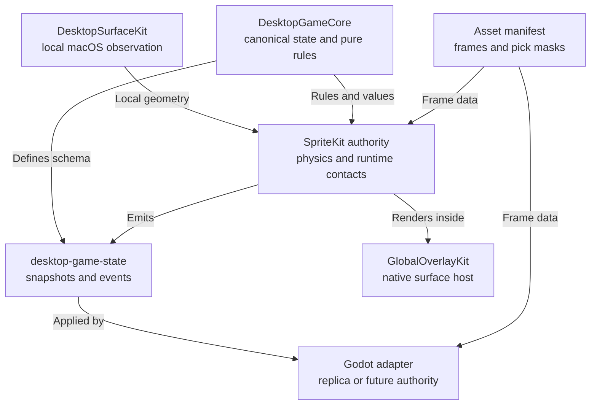

# ADR-0005 - Separate Portable Game State From Observation And Engine Runtime

## Context

Desktop Physics currently proves one useful SpriteKit implementation, but much
of its gameplay truth still lives inside `SKScene`, `SKNode`, `SKPhysicsBody`,
private timers, and renderer-specific coordinates. That makes the current demo
hard to replicate over a network and expensive to move to Godot.

The intended multiplayer experience must reconstruct the semantic desktop
world without receiving a screenshot. A peer needs privacy-filtered surfaces,
avatars, objects, gameplay-visible state, and asset identities. It does not
need local window titles, Window Server numbers, decoded texture pixels, or a
physics engine's contact cache.

The longer-term product direction includes an existing Godot flat-to-depth
prototype. The first portable schema must therefore represent real X/Y/Z
state; shipping a two-dimensional schema and immediately breaking it would
create avoidable compatibility debt.

The architecture therefore needs to distinguish four categories that the
current SpriteKit scene partially conflates:

1. local macOS observation facts;
2. canonical and network-replicable game state;
3. authoritative engine and solver state;
4. renderer-only presentation state.

The decision must also preserve the existing boundaries: GlobalOverlayKit
hosts native content, DesktopSurfaceKit observes windows and derives geometry,
and game engines own rendering and physics.

## Candidates

### Candidate A - Add Codable Views To DesktopPhysicsKit

Expose snapshots directly from the current SpriteKit-backed target while
leaving gameplay policy in the scene.

Strengths:

- smallest immediate source change;
- can capture the current demo quickly.

Risks:

- the nominally portable model would still inherit SpriteKit types, identity,
  coordinate choices, animation timing, and solver behavior;
- a Godot authority would need to reproduce or bypass SpriteKit-owned rules;
- serialization would become a view over engine state rather than a game-state
  source of truth.

### Candidate B - Add One Pure DesktopGameCore Target

Create a nested target that imports no AppKit, Core Graphics, SpriteKit, or
Godot modules. It owns portable value state, stable session identities,
versioned envelopes, semantic input and event vocabulary, and small
deterministic gameplay policies. SpriteKit remains the first authoritative
physics adapter.

Strengths:

- makes state, rules, and engine ownership explicit without creating several
  speculative packages;
- gives SpriteKit, Godot, tests, and network fixtures the same vocabulary;
- supports an engine swap without placing a universal lifecycle or physics API
  between the game and each engine;
- lets runtime alpha sampling and physics contacts remain efficient adapter
  details.

Risks:

- current scene state must be mapped deliberately instead of mechanically
  encoded;
- version 1 cannot promise exact mid-contact authority migration because solver
  caches remain private;
- the target name may change after a real Godot consumer validates it.

### Candidate C - Split State, Rules, Assets, And Network Packages Now

Create separate targets for each conceptual responsibility before the Godot
consumer exists.

Strengths:

- maximally explicit dependency graph.

Risks:

- freezes package boundaries before two call sites reveal their real shape;
- increases versioning, documentation, and migration cost without evidence;
- encourages a general entity-component system or universal engine API.

## Decision

Choose Candidate B.

Add a pure nested `DesktopGameCore` target before implementing the next
SpriteKit-specific feature wave. The original extraction gate required both
the current SpriteKit authority and a real Godot consumer to validate the
public contract. The extraction result below narrows that timing gate without
changing the later rendered-consumer acceptance boundary.
The wire protocol is named `desktop-game-state`; the module name does not make
JSON encoding its only job.

`DesktopGameCore` owns:

- versioned, explicit-`Double`, `Codable` game-state values;
- world-session, entity, surface, input, event, tick, and sequence identities;
- a coordinate convention independent from Quartz, SpriteKit, and Godot;
- semantic input commands and gameplay events;
- pure state transitions such as jump admission, drop-through, wall traversal,
  and front-to-back draggable selection;
- content-addressed asset, animation-frame, and pick-mask references.

It does not own:

- macOS window enumeration, focus observation, permission prompting, or titles;
- physics bodies, collision contacts, solver caches, rendering nodes, textures,
  alpha-mask decoding, pointer capture, or interpolation buffers;
- multiplayer transport, accounts, matchmaking, servers, or asset delivery.

Use one authoritative simulation. SpriteKit is the first authority and emits
portable snapshots/events. Godot may render a replica from those values. A
future Godot authority may emit the same values after consuming the separate
desktop-window observation feed. SpriteKit and Godot are not required to
produce deterministic matching trajectories. Lockstep would require a future
fixed-step deterministic physics core and a separate decision.

Start with fixture-tested JSON or newline-delimited JSON. Encoding can move to
a measured binary format later without changing the domain schema.

## Validation and extraction result

The nested Swift target first proved the contract and the SpriteKit interaction
policies. A separate Godot 4.6 headless consumer then accepted the same planar
and true-depth fixtures. That headless evidence is sufficient to validate the
repository/decode boundary, but it does not replace the still-required rendered
Godot consumer canary. On that narrower evidence, `DesktopGameCore` moved to
the private local sibling repository at
`/Users/macintoso/Documents/VSCode/DesktopGameCore`, and Desktop Physics now
uses its Swift product through a local path. The sibling repository owns the
JSON Schema, fixtures, Swift tests, and Godot add-on. It has no remote, tag, or
public release. The sibling's ADR-0001 records why this extraction timing
changed while preserving the engine and human-acceptance boundaries.

Because GlobalOverlayKit is public and DesktopGameCore is private, the tracked
Desktop Physics package is now an explicitly optional credentialed/paired-
workspace example. Root checks and CI run it fully when the sibling exists and
loudly skip only that example when it does not. Clone-portable options remain
open: a credentialed private tag, moving the demo private, or separately
authorizing a public core.

## Three-Dimensional Coordinate Contract

Use one right-handed world coordinate system:

- positive X points screen-right;
- positive Y points screen-up;
- positive Z points toward the viewer;
- negative Z points into the world;
- the collapsed desktop is the plane `Z = 0`.

This matches Godot's convention that camera-forward is negative Z. The
flat-to-depth transition moves world content primarily toward negative Z.

Entity pose contains a three-component position and a normalized quaternion.
Linear velocity and angular velocity are three-component vectors; angular
velocity is radians per second around X/Y/Z. Gameplay facing remains a
separate normalized direction when it conveys intent. Billboard behavior is
renderer-only.

DesktopSurfaceKit never assigns world depth. After Quartz-to-world conversion,
observed window geometry begins at `Z = 0`. Game policy chooses whether a
platform's collision extrusion spans the playable depth, occupies a narrow
band, or moves during the depth transition.

Desktop `zIndex` remains observation/occlusion order and becomes
`desktopLayerRank` in portable provenance. It must never be interpreted as
world Z. Tiny renderer offsets used to avoid z-fighting are adapter-private.

The SpriteKit adapter supports only the planar subset: position and linear
velocity Z are zero, orientation rotates only around Z, angular velocity X/Y
are zero, and surfaces are consumed as XY segments. It must reject a genuinely
nonplanar authoritative snapshot as unsupported rather than silently flatten
it. Godot may consume both the planar subset and future depth.

## Ownership And Data Flow

Arrows in this diagram mean semantic data movement, not a mandate for push,
polling, or a particular network transport.



The authority consumes pure rules and value definitions, then emits a
canonical packet after simulation. The packet is an artifact, not shared
mutable state inside `DesktopGameCore`.

## Portable State Contract

The first schema is shaped as follows. Exact Swift names may change during the
implementation brief, but ownership and compatibility semantics do not.

```text
DesktopGameEnvelopeV1 {
  protocolMajor, schemaVersion,
  worldSessionID, sequence, baseSequence?, tick,
  payload: snapshot | delta | inputs | events
}

DesktopGameSnapshotV1 {
  viewport: { id, width, height, depthRange,
              origin: screenPlaneBottomLeft,
              axes: rightHanded_xRight_yUp_zTowardViewer,
              units: worldUnits }
  rules: { revision, fixedTickRate, gravity, controllerProfile,
           collisionToggles, materialTable }
  surfaces: [{ id, sourceGroupID, sourceSide, desktopLayerRank,
               geometry: { kind: extrudedSegment,
                           start: Vec3, end: Vec3,
                           thickness, depthRange },
               collisionRoles }]
  focusedSourceGroupID?
  avatars: [{ id, ownerID?, pose, linearVelocity, facing,
              locomotion, visual }]
  objects: [{ id, shape, pose, linearVelocity,
              angularVelocity, materialRef }]
}

Vec3 { x: Double, y: Double, z: Double }
Quaternion { x: Double, y: Double, z: Double, w: Double }
Pose3D { position: Vec3, orientation: Quaternion }
Kinematics3D { linearVelocity: Vec3, angularVelocity: Vec3 }
```

The visual reference contains an asset revision, animation clip/frame or
normalized phase, draw transform, and pick-mask reference. A receiver resolves
the same local mask; state packets do not carry per-frame pixels. A custom
avatar is an out-of-band content-addressed asset transfer, not repeated game
state.

## Identity And Update Rules

- `worldSessionID` is a new UUID for each hosted world session.
- Authority-minted entity IDs are never reused within that session.
- A raw macOS window number is valid only within its local observation epoch.
- Peers receive random session-local `sourceGroupID` aliases, never Window
  Server IDs, process IDs, application names, titles, or document metadata by
  default.
- A surface ID derives from the world session, source alias, side, and
  quantized endpoints. Geometry change is remove/add, not durable window
  identity.
- A joining or recovering replica receives a full snapshot. Each delta names
  one exact base sequence; missing or reordered bases require a full snapshot.
- Tick orders simulation. Sequence orders transmitted state. A replica may
  interpolate but cannot silently become authoritative.
- A replica applies state through one exclusive coordinator operation. Under
  the same lock it validates the session, base sequence, sequence, and tick;
  invokes one nonescaping synchronous throwing payload-application closure;
  then commits the new session, sequence, and tick. A rejected envelope never
  invokes the closure, and a thrown application never advances sequencing.

## Interaction Seams

The visible avatar, physics collider, and draggable region are separate
contracts.

- Portable state names an asset, frame, transform, and pick mask.
- The SpriteKit/Godot adapter decodes and caches that immutable mask.
- The adapter converts the world point into normalized visual coordinates and
  reports painted coverage to a pure front-to-back selection policy.
- Physics geometry never decides whether a pointer captures the avatar.

Wall traversal is likewise a pure state machine over contacted feature IDs,
wall direction, and plane. Toward-wall plus a fresh Jump begins exclusion of
every feature coincident with that contacted plane within one explicit finite
tolerance. During active traversal, exclusion is independent of the feature's
current player-relative direction because that direction flips when the
player's center crosses the plane. The initial direction is retained only to
decide when the previous-frame player bounds have fully cleared the plane.
Distinct planes remain collidable. Away-wall or neutral plus Jump remains an
outward wall jump. SpriteKit owns velocity/body mutation and live collision
probing.

The first wall-phase implementation covers visible window edges only. Screen
and loose-object walls remain unphaseable until their collision features have
stable individual identities.

## Consequences

Positive:

- the desktop can be reconstructed from compact semantic values rather than a
  screen recording;
- privacy filtering happens before state leaves the host;
- SpriteKit and Godot can share fixtures, identities, coordinates, assets, and
  visible outcomes without sharing engine objects;
- alpha-perfect picking remains consistent across engines while avoiding
  per-frame pixel transfer;
- gameplay policies become unit-testable without presenting an `SKScene`.

Costs and limitations:

- v1 replicates gameplay-visible state but cannot exactly resume every
  authority-private contact or solver warm-start;
- adapters must map y axes, units, materials, animation phases, and edge
  provenance explicitly;
- asset manifests and masks require their own cache/version tests;
- JSON performance and snapshot rate need measurement before their budgets are
  described as accepted.

## Rejected Alternatives

- Serializing `SKScene`, `SKNode`, `SKPhysicsBody`, Godot nodes, or engine
  resources.
- Sending raw DesktopSurfaceKit snapshots or desktop identity metadata to
  peers.
- Sending screenshots or per-frame avatar pixels as game state.
- Treating fragment ordinals, localized app names, or Window Server numbers as
  cross-device identity.
- Building a universal engine lifecycle protocol or entity-component system.
- Selecting FlatBuffers, MessagePack, or another binary encoding before a
  measured JSON fixture fails a payload or latency budget.

## Verification Gates

- Golden fixtures decode to equal semantics in Swift and Godot.
- Version tests reject unsupported required fields and tolerate unknown
  optional fields under the documented compatibility rule.
- Snapshot/delta loss, reordering, duplicate, and full-recovery cases pass.
- Privacy fixtures contain no title, app name, process ID, Window Server ID, or
  document metadata by default.
- Coordinate fixtures cover y-axis conversion, display scale, and viewport
  origin, plus planar Z=0 projection.
- Two windows with different desktop layer ranks remain at world Z=0 unless an
  explicit game projection changes them.
- Godot accepts a depth-moving, non-Z-rotated fixture while SpriteKit rejects
  that nonplanar authority state instead of flattening it.
- Vector fields reject nonfinite values; quaternions reject zero or
  non-normalizable values.
- Known opaque and transparent asset points resolve identically in SpriteKit
  and Godot, including mirroring and trimmed frames.
- Cross-engine playback compares surfaces, poses, animation, and events, not
  solver trajectories.
- Payload size and encode/decode time are measured before changing encoding.

## Open Decisions

- Whether the shared viewport uses the selected display's visible frame or
  full frame.
- Whether desktop platform collision spans all playable depth, a narrow band
  around zero, or changes during the flat-to-depth transition.
- Whether focused-surface sharing is useful enough for an explicit privacy
  toggle.
- Snapshot cadence, numeric quantization, and asset-distribution policy.
- Whether future host migration requires a larger authority-checkpoint schema.

## Maintenance Rule

Keep local desktop observation, canonical game state, engine-private solver
state, and renderer-only state distinct. An engine swap may change adapters;
it must not change the meaning of the portable game-state protocol.
