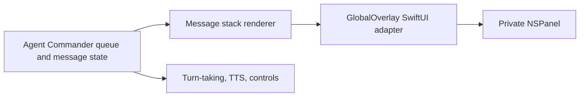
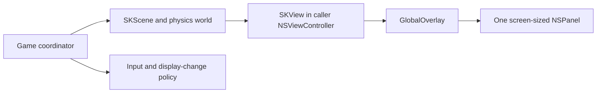

# Architecture

GlobalOverlayKit is a renderer-neutral overlay surface host for macOS. The
stable boundary is one caller-owned native content controller hosted by one
package-owned surface. AppKit windowing is deliberately hidden beneath that
boundary.

For verified current truth rather than intended direction, read
[CURRENT_STATE.md](CURRENT_STATE.md).

## Product Boundary

The package owns:

- transparent, non-activating AppKit surface creation
- surface visibility and frame changes
- pointer pass-through versus pointer-interactive mode
- all-Spaces and full-screen auxiliary collection flags
- basic movement, resize, minimum-size, shadow, accessibility-label, and
  AppKit frame-autosave configuration
- arbitrary `NSViewController` hosting
- a SwiftUI convenience adapter

The package does not own:

- message or transcript models and rendering
- speech, agents, turn-taking, or notification policy
- SpriteKit, Metal, pixel engines, scene state, physics, or render loops
- global keyboard hooks, hotkeys, voice commands, or Accessibility permission
- consumer persistence, screen-selection policy, or multi-overlay orchestration

## Reality Check

The initial source matches this narrow boundary: `GlobalOverlay` wraps a private
`NSPanel`, while `GlobalOverlayConfiguration` describes surface mechanics.
There is no consumer integration or physical behavior evidence yet. If this doc
and [CURRENT_STATE.md](CURRENT_STATE.md) diverge, current state wins for what is
built and this doc wins only for intended boundaries.

## Decision Provenance

| Claim | Source |
|---|---|
| Current package truth | [CURRENT_STATE.md](CURRENT_STATE.md) |
| Requirements | [SPEC-0001](../product/specs/SPEC-0001-global-overlay-surface-host.md) |
| Content remains caller-owned | [ADR-0001](../decisions/adr/ADR-0001-keep-content-and-product-behavior-outside-the-overlay-host.md) |
| Prior-art and bounded package search | [RSCH-0001](../research/RSCH-0001-global-overlay-prior-art-and-package-boundary.md) |
| Initial implementation milestone | [PLAN-0001](../product/plans/PLAN-0001-clean-room-overlay-host-mvp/PLAN-0001-clean-room-overlay-host-mvp.md) |
| Verification limits | [Testing guide](../repo-health/testing-guide.md) |

## Architecture Area

| Area ID | Doc | Owns |
|---|---|---|
| `AREA-OVERLAY-HOST` | [AREA-OVERLAY-HOST.md](../architecture/areas/AREA-OVERLAY-HOST.md) | One native overlay surface and its renderer-neutral content seam |

## Tech Stack

| Layer | Technology |
|---|---|
| Package | Swift Package Manager, Swift 6 language mode |
| Windowing | AppKit `NSPanel` and `NSScreen` |
| Canonical content seam | AppKit `NSViewController` |
| SwiftUI adapter | `NSHostingController<Content>` |
| Contract verification | Swift Testing plus AppKit property inspection |
| Supported platform | macOS 13 and later |

## Canonical Seams

### Core AppKit seam

The caller-facing shape currently is:

```swift
@MainActor
public final class GlobalOverlay {
    public init(
        configuration: GlobalOverlayConfiguration,
        contentViewController: NSViewController
    )

    public func show()
    public func hide()
    public func setInteraction(_ interaction: GlobalOverlayInteraction)
    public func setFrame(_ frame: CGRect, display: Bool)
    public func fill(_ screen: NSScreen, includeMenuBarAndDock: Bool, display: Bool)
}
```

This is an instance API, not a global singleton. Multiple surfaces and screens
are represented by multiple instances coordinated by the consuming app.

### SwiftUI convenience seam

The generic convenience initializer creates `NSHostingController` internally.
It removes boilerplate for SwiftUI consumers but does not make message views or
SwiftUI state part of the package model.

### Renderer seams

Arbitrary native content fits through `NSViewController`:

- AppKit callers supply their controller directly.
- SwiftUI callers use the convenience initializer or an explicit hosting
  controller.
- SpriteKit callers place an `SKView` inside their controller.
- Metal callers place an `MTKView` inside their controller.

The package should not gain `tick`, `updateScene`, message, physics, or global
input callbacks to support those renderers.

## Critical Consumer Flows

### Agent Commander message overlay



Agent Commander owns every box except `GlobalOverlay` and its private panel.
Streaming message updates occur inside the caller's SwiftUI state, not through a
GlobalOverlayKit message API.

### SpriteKit desktop world



The game moves sprites inside one screen-sized surface. It must not animate one
`NSWindow` per character or ask the package to own gravity and collision state.

## Multiple Displays And Interaction

- One overlay instance owns one panel and one frame.
- A consumer may create one instance per display or use a smaller fixed frame.
- The current `screenFilling` and `fill(_:)` APIs snapshot `NSScreen` geometry.
  The consumer owns monitoring and reapplying layout after topology changes.
- Pointer pass-through maps to `NSWindow.ignoresMouseEvents`.
- Pointer interaction, application activation, key focus, global shortcuts, and
  Accessibility-based keyboard capture are separate concerns. Only the first
  is currently modeled.
- Interactive content needs a visible, keyboard-reachable recovery path in the
  consuming application; the package must not create unrecoverable UI.

## Working Rules

- Keep `NSPanel` private and the `NSViewController` seam public.
- Keep every public lifecycle operation on the main actor.
- Add shared coordination only after at least two real consumers require the
  same policy.
- Treat AppKit collection behavior as a requested mechanism until physically
  verified.
- Preserve clean-room implementation from Apple APIs; research projects are
  comparison evidence, not donor code.

## Module Layout

```text
Sources/GlobalOverlayKit/
  GlobalOverlay.swift
  GlobalOverlayConfiguration.swift

Tests/GlobalOverlayKitTests/
  GlobalOverlayTests.swift
```

The package should remain one module until a real dependency or ownership split
makes a second module cheaper than the extra public surface.

## Replaceability Targets

The AppKit creation mechanism may change behind `GlobalOverlay`; the caller's
content controller and product state should not. A future implementation could
refine `NSPanel` construction without forcing Agent Commander or a game to
rewrite its renderer.

What should not be abstracted yet:

- display fleets or overlay registries
- activation/focus strategies beyond the proven need
- a renderer protocol
- message or game lifecycle protocols
- animation and transition systems
- global input, accessibility, or persistence services

The durable seam is intentionally small: one native content controller inside
one overlay surface.
