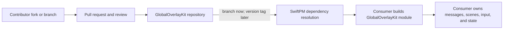

# EXPL-0001 - Using And Contributing To GlobalOverlayKit

## Use This When

Read this if you want to add GlobalOverlayKit to an application, change it for a
real consumer, or understand how an open-source Swift package moves from a pull
request into downstream applications.

## Short Answer

Swift Package Manager (SwiftPM) resolves this repository as a dependency and
builds the `GlobalOverlayKit` module for the consuming app. You do not copy the
source into Agent Commander. To contribute, change this repository on a branch,
run its checks, and submit a pull request; consumers receive the change only
after it is merged and they update the dependency revision or release.

The package has no tagged release yet, so branch-based use is explicitly
pre-release and can change.

## Mental Model



SwiftPM handles dependency source and module builds. GitHub handles proposed
changes and review. Neither transfers product ownership into the package.

## Consuming The Package

Before a first release, `Package.swift` may track the main branch:

```swift
dependencies: [
    .package(
        url: "https://github.com/owensantoso/global-overlay-kit.git",
        branch: "main"
    )
]
```

Then add the `GlobalOverlayKit` product to the application target and import it:

```swift
import GlobalOverlayKit
```

Xcode can perform the same operation through **File > Add Package
Dependencies**. Swift's official [SwiftPM getting-started guide](https://www.swift.org/getting-started/swiftpm/)
and [`PackageDescription` reference](https://docs.swift.org/package-manager/PackageDescription/PackageDescription.html)
describe the manifest and dependency rules.

Branch dependencies are convenient during joint development but do not offer a
semantic-version compatibility promise. After the first tagged release,
consumers should normally use an explicit compatible version range and review
dependency updates rather than silently following every commit.

## Using The API Without Breaking The Boundary

- SwiftUI message overlays use the convenience initializer and keep messages,
  streaming state, controls, and speech in the consuming app.
- AppKit, SpriteKit, and Metal consumers provide an `NSViewController`.
- One `GlobalOverlay` owns one surface. The app coordinates several instances
  if it needs several displays or overlay types.
- The app provides recovery controls and owns display-change or input policy.

Read [SPEC-0001](../../product/specs/SPEC-0001-global-overlay-surface-host.md)
before proposing a public API change.

## Contributing A Change

1. Start with a concrete consumer problem and check
   [CURRENT_STATE.md](../CURRENT_STATE.md).
2. Create a branch in the repository, or fork it if you do not have write
   access. GitHub documents [forks](https://docs.github.com/en/pull-requests/collaborating-with-pull-requests/working-with-forks/about-permissions-and-visibility-of-forks)
   and [pull requests from forks](https://docs.github.com/en/pull-requests/collaborating-with-pull-requests/working-with-forks/creating-a-pull-request-from-a-fork).
3. Make the smallest boundary-preserving change and add focused tests.
4. Run `./run check`.
5. Record what was automated versus physically observed.
6. Open a pull request explaining the consumer, API effect, provenance, and
   evidence.
7. A maintainer reviews and merges or requests changes. A fork or pull request
   alone does not update downstream applications.
8. Consumers update their resolved branch revision or released package version.

## Licensing And Provenance

The repository uses the [MIT License](../../../LICENSE). Contributions are
accepted under that license. Preserve the license notice when required and do
not paste code from another project just because its repository is public.

Prior-art links belong in research. Source code enters this package only through
clean-room implementation from public Apple APIs or an explicit, reviewed
license/dependency decision. This is project process, not legal advice.

## Common Misunderstandings

- **“Adding a package copies a second app into mine.”** SwiftPM resolves and
  builds a library product; Agent Commander still owns its own app code.
- **“Open source means any visible code is safe to paste.”** Copyright and
  licenses still apply. This package uses clean-room Apple-API implementation.
- **“My pull request immediately changes every consumer.”** It changes nothing
  until reviewed and merged, and consumers still choose when to update.
- **“SwiftUI is the package architecture.”** SwiftUI is one adapter. The
  canonical seam is `NSViewController`.
- **“Passing tests proves an always-on-top overlay works everywhere.”** Current
  tests prove configured properties, not physical Spaces, focus, or input.

## Check Your Understanding

- Where do Agent Commander message models live?
  - In Agent Commander, not GlobalOverlayKit.
- What should a SpriteKit consumer pass to the package?
  - A caller-owned view controller containing its `SKView`.
- When does a pull request affect a consuming app?
  - After merge and after the consumer updates its dependency revision/version.
- What must accompany a physical behavior claim?
  - An observed result with the relevant Mac, macOS, display, activation, and
    configuration context.

## Related Docs

- [Architecture](../ARCHITECTURE.md)
- [Testing guide](../../repo-health/testing-guide.md)
- [Prior-art research](../../research/RSCH-0001-global-overlay-prior-art-and-package-boundary.md)
- [Contributing guide](../../../CONTRIBUTING.md)
