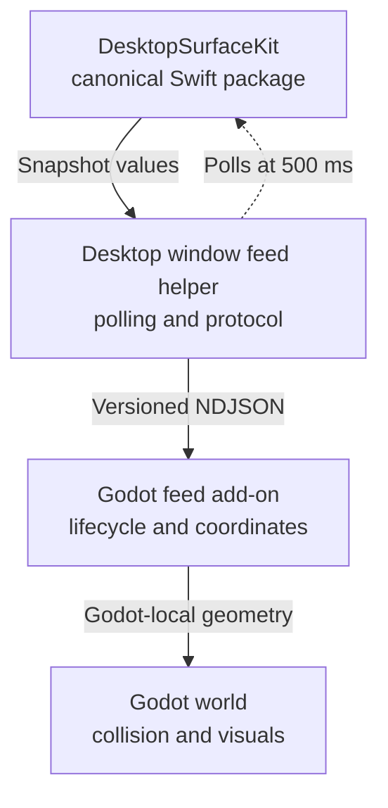

# EXPL-0002 - Godot Desktop Window Feed Contract

## Use This When

Read this before implementing a Godot consumer of macOS window geometry. It
defines the proposed plug-in call site, process lifecycle, snapshot schema,
identity, coordinates, cadence, failures, versioning, packaging, and the gates
that separate a useful transport proof from collider-ready geometry.

The architecture decision is [ADR-0004](../../decisions/adr/ADR-0004-bridge-desktopsurfacekit-to-godot-through-a-versioned-snapshot-feed.md).

## Short Answer

Build a small signed Swift helper that imports the canonical
`DesktopSurfaceKit` package and emits versioned newline-delimited JSON (NDJSON).
Godot starts and stops the helper, validates snapshots, converts global Quartz
coordinates, and owns every physics/presentation decision.

Do not implement the bridge yet. A local Godot 4.6.1 pipe probe passed, but the
current Retina screen produced different Core Graphics and Godot sizes. The
first implementation task must prove explicit display mapping and a signed
embedded-helper export.

## Existing Reuse Map

| Existing component | Reuse in a Godot path | Ownership that must remain |
|---|---|---|
| `MacDesktopWindowSnapshotter` | Helper calls it directly for filtered current-Space source windows | `DesktopSurfaceKit` owns Core Graphics enumeration, filtering, global Quartz frames, live window IDs, process metadata, availability, and front-to-back order |
| `VisibleRegionExtractor` | Helper serializes its fragments and `sourceSides` | `DesktopSurfaceKit` owns deterministic rectangle subtraction and axis-neutral source-side provenance |
| `MacDesktopWindowGeometryProvider` | Reference behavior only; do not link the whole type into Godot | Desktop Physics owns its Accessibility gate, selected-SpriteKit-scene conversion, and product messages |
| `DesktopPhysicsWorld` 500 ms task | Initial cadence hypothesis, not reusable code | Each consumer adapter owns polling, cancellation, staleness, and UI status |
| `DesktopWindowPlatformPolicy` and `DesktopPhysicsScene` | Never pass through the feed | Each engine owns object collision, player landing, walls, anti-crush, and rendering |
| `GlobalOverlayKit` | Independent surface-host option | Overlay mechanics remain renderer-neutral; the existing Godot POC is still an engine-owned normal window |

This reuses one observation implementation. It does not promise one machine-wide
snapshot call: independently running SpriteKit and Godot consumers may poll the
same package separately. A singleton broker is deferred.

## Mental Model



The dashed arrow is the consumer-owned poll. Solid arrows are returned data.
Neither the package nor feed knows what becomes a floor, wall, object collider,
or outline.

## Ownership Boundary

The helper owns:

- one pinned `DesktopSurfaceKit` dependency;
- one helper-process session and snapshotter;
- the initial 500 ms cadence;
- caller-supplied process exclusions;
- visible-fragment extraction;
- protocol validation, revision numbering, and stderr diagnostics;
- unavailable snapshots that force consumers to clear stale geometry.

The helper refuses to own:

- Accessibility trust or permission UI;
- selected-display policy before the coordinate gate passes;
- Godot, SpriteKit, AppKit view, or physics types;
- collisions, one-way semantics, bounce, walls, anti-crush, or outlines;
- a persistent machine-wide daemon;
- IDs beyond one live window/helper session.

The Godot add-on owns:

- helper start, health, retry, and teardown;
- selected-screen and viewport conversion;
- last-received time and stale-feed fail-off;
- mapping protocol values to Godot-native values;
- visible status and recovery.

The Godot game owns every collision and presentation policy.

## Godot-Facing Interface

Expose one autoload or ordinary node:

```gdscript
DesktopWindowFeed.start({
    "helper_path": ProjectSettings.globalize_path(
        "res://addons/desktop_window_feed/bin/desktop-window-feed"
    ),
    "interval_ms": 500,
    "excluding_process_ids": [OS.get_process_id()]
})

DesktopWindowFeed.snapshot_changed.connect(_apply_window_snapshot)
DesktopWindowFeed.status_changed.connect(_show_window_feed_status)

# Disable, editor reload, or tree exit:
DesktopWindowFeed.stop()
```

Required state:

```text
state = stopped | starting | available | unavailable | failed
session_id: String
latest_revision: int
latest_snapshot: Dictionary
status_code: String
status_message: String
```

`snapshot_changed` carries data, never physics bodies. `status_changed` covers
startup, availability, staleness, malformed data, protocol mismatch, helper
exit, and recovery. Starting while active stops the old session first. Stopping
is idempotent.

## Protocol Version 1

Use UTF-8 NDJSON: exactly one JSON object per newline. Standard output contains
protocol objects only; standard error contains human diagnostics. Reject a line
over 1 MiB, invalid UTF-8, invalid JSON, mismatched protocol major, or missing
required fields and immediately clear geometry.

The first object is:

```json
{"kind":"hello","protocol":"desktop-window-feed","protocol_version":1,"helper_version":"0.1.0","session_id":"<uuid>","coordinate_space":{"name":"global_quartz","origin":"main_display_top_left","x_axis":"right","y_axis":"down","units":"core_graphics_screen_space"}}
```

Available snapshot:

```json
{"kind":"snapshot","protocol_version":1,"session_id":"<uuid>","revision":12,"status":{"state":"available"},"sources":[{"window_id":"431","process_id":1234,"application_name":"Example","z_index":0,"frame":{"x":20,"y":40,"width":900,"height":600}}],"fragments":[{"fragment_id":"visible:431:0","source_window_id":"431","source_index":0,"fragment_index":0,"source_sides":["minY","maxX","maxY","minX"],"frame":{"x":20,"y":40,"width":900,"height":600}}]}
```

Unavailable observation is not available-empty:

```json
{"kind":"snapshot","protocol_version":1,"session_id":"<uuid>","revision":13,"status":{"state":"unavailable","code":"window_server_unavailable","retryable":true},"sources":[],"fragments":[]}
```

Contract rules:

- `window_id` identifies one live Window Server window lifetime inside the
  current helper session. Never persist it across launches.
- `fragment_id` is deterministic for the current extraction result but may
  disappear or be replaced when occlusion changes. It is not durable identity.
- `z_index` and `source_index` are order, not identity.
- `application_name` is optional display metadata.
- `source_sides` uses only `minX`, `maxX`, `minY`, and `maxY`. The consumer
  assigns visual meaning after conversion.
- `available` with empty arrays successfully clears all geometry.
- `unavailable`, transport loss, helper exit, protocol error, or staleness
  clears geometry immediately. Recovery requires a fresh available snapshot.
- Revisions increase within one `session_id`. Apply only the newest complete
  revision and discard intermediate buffered snapshots when needed.
- Unknown optional fields are ignored in version 1. Removing, renaming, or
  changing the type/meaning of a required field requires version 2.

## Lifecycle And Cadence

1. Globalize the embedded helper path and call
   `OS.execute_with_pipe(..., blocking = false)`.
2. Pass the 500 ms cadence and all excluded process IDs. The package excludes
   the helper itself; Godot must pass its own PID.
3. Require `hello` before accepting snapshots. Timeout, early exit, or an
   incompatible protocol changes state to `failed` and clears data.
4. Drain only complete lines without blocking the Godot frame loop. Record
   receiver time locally; a helper wall clock is not a staleness clock.
5. No complete snapshot within two expected intervals changes state to
   `unavailable` and clears data. A later valid snapshot may recover.
6. On disable, editor reload, project exit, or node teardown, close the pipes
   and terminate the returned PID. Godot documents that the child otherwise
   outlives the engine.
7. Start with a visible manual retry. Any future automatic restart must be
   bounded and surfaced.

The 500 ms value comes from Desktop Physics, not the package. Measure before
offering a faster preset. Never snapshot on a physics or render frame.

## Coordinate Contract And Gate

Version 1 carries raw global Quartz geometry:

- origin at the main display's upper-left;
- positive X right and positive Y down;
- frames may span displays;
- units are Core Graphics screen-space units, not promised points or pixels.

Godot documents `screen_get_position` and `screen_get_size` in pixels and
reports per-screen scale. The local single-Retina probe found:

| Source | Position | Size | Scale |
|---|---:|---:|---:|
| Core Graphics display bounds | `(0, 0)` | `1800×1169` | not supplied |
| Godot 4.6.1 `DisplayServer` | `(0, 0)` | `3600×2338` | `2.0` |

The implementation must expose a pure mapping that takes the Quartz selected-
display frame plus the Godot selected-screen pixel rectangle and scale. It must
fail off when no unambiguous match exists. Acceptance requires 1× and 2×
displays, mixed scale, and a display above or left of main. Until those pass, do
not describe values as collider-ready Godot-local geometry.

## Versioning And Packaging

Version three contracts independently:

1. `DesktopSurfaceKit` follows its Swift package semantic-version policy. Pin
   release candidates exactly; after final acceptance use `upToNextMinor`
   within the 0.1 line and commit resolver state.
2. The helper/add-on use their own semantic version. Patch releases preserve
   the documented wire contract.
3. `protocol_version` changes only for wire compatibility. Additive optional
   fields stay in version 1; required-field or semantic breaks use version 2.

Build the helper as a Universal 2 executable. Embed it through Godot's
**Helper Executable** macOS export option and sign nested code with the same
stable Apple Development or distribution identity as the exported app.
Sandboxed Godot apps may execute only helpers configured into the export. Verify
the app, helper, entitlements, and resolver receipt separately from an editor
run.

The Godot project does not resolve the private Swift package. The embedded
helper binary contains that implementation; the add-on depends only on the
protocol and executable.

## Why A GDExtension Is Second

Current SwiftGodot supports Godot 4.6 and requires Swift 6.3, so the local
versions align. It is still a new community dependency, and this workspace has
no local checkout or package cache. A SwiftGodot extension also introduces a
dynamic library, `.gdextension` file, Godot-minor compatibility, export staging,
library validation/signing, and shared crash fate.

Those costs may be justified if measured helper transfer or packaging fails.
They are not justified merely to avoid a small JSON contract at a 500 ms poll,
especially because native in-process access does not solve display conversion.

## Implementation Gates

- [ ] Choose the future Godot consumer repository; do not retrofit the existing
      flat-to-depth POC without explicit scope approval.
- [ ] Install Godot 4.6.1 export templates and record their source/version.
- [ ] Implement encoder/decoder fixtures and malformed-input fail-off.
- [ ] Implement and test explicit Quartz-to-Godot display mapping.
- [ ] Prove single-Retina, 1× external, mixed-scale, and above/left layouts.
- [ ] Build and embed a Universal 2 helper through the macOS export preset.
- [ ] Sign the app and nested helper with stable identities and verify both.
- [ ] Prove exclusion of both helper and Godot process windows.
- [ ] Kill the helper, remove/move/resize a window, and change Space while
      confirming stale geometry clears.
- [ ] Measure snapshot, encode, transfer, decode, and window-count load.
- [ ] Compare SwiftGodot only if process or packaging cost fails a budget.

## Current Verification

- `/Applications/Godot.app` is official signed Godot 4.6.1.
- Swift 6.3.3 is installed.
- A local `execute_with_pipe` probe launched `/usr/bin/printf`, received a PID,
  and nonblockingly read `{"kind":"hello"}`.
- The live coordinate probe produced the 2× Retina mismatch above.
- No local SwiftGodot checkout/package cache was found.
- The Godot export-template directory exists but contains no installed
  versioned templates, so a signed exported helper has not been built.

These are tool and mechanism checks. They do not prove exported app behavior,
multi-display coordinates, window lifecycle, latency, or collision feel.

## Common Misunderstandings

- **“Engine-neutral means a universal physics schema.”** It means the feed
  reports geometry without deciding what it does in a game.
- **“One package means one system-wide poll.”** It means one implementation.
  Concurrent consumers may still poll independently until a broker is justified.
- **“Retina scale is always multiply by two.”** That is one live result, not the
  mixed-display contract.
- **“A GDExtension solves coordinates.”** It changes transport, not the two
  coordinate systems.
- **“Editor success proves distribution.”** Exported nested code, signing,
  sandbox execution, and physical behavior are separate gates.

## Primary Sources

- Godot [`OS.execute_with_pipe`](https://docs.godotengine.org/en/stable/classes/class_os.html#class-os-method-execute-with-pipe)
- Godot [`FileAccess`](https://docs.godotengine.org/en/stable/classes/class_fileaccess.html)
- Godot [`DisplayServer`](https://docs.godotengine.org/en/stable/classes/class_displayserver.html)
- Godot [macOS export guide](https://docs.godotengine.org/en/stable/tutorials/export/exporting_for_macos.html)
- Godot [GDExtension overview](https://docs.godotengine.org/en/stable/tutorials/scripting/gdextension/what_is_gdextension.html)
- Primary [SwiftGodot repository](https://github.com/migueldeicaza/SwiftGodot)
  and [release history](https://github.com/migueldeicaza/SwiftGodot/releases)
- Primary [`godot-cpp` repository](https://github.com/godotengine/godot-cpp)

## Related Docs

- [ADR-0004 - helper-feed decision](../../decisions/adr/ADR-0004-bridge-desktopsurfacekit-to-godot-through-a-versioned-snapshot-feed.md)
- [AREA-DESKTOP-PHYSICS](../../architecture/areas/AREA-DESKTOP-PHYSICS.md)
- [SPEC-0002](../../product/specs/SPEC-0002-reusable-desktop-physics-world.md)
- [RSCH-0006 - engine compatibility](../../research/RSCH-0006-game-engine-overlay-compatibility-layer.md)
- [ADR-0003 - DesktopSurfaceKit version gates](../../decisions/adr/ADR-0003-promote-desktopsurfacekit-through-versioned-compatibility-gates.md)

## Maintenance Rule

Preserve the engine-neutral snapshot domain even if transport changes. Start
implementation with coordinates and signed export, not collider creation.
